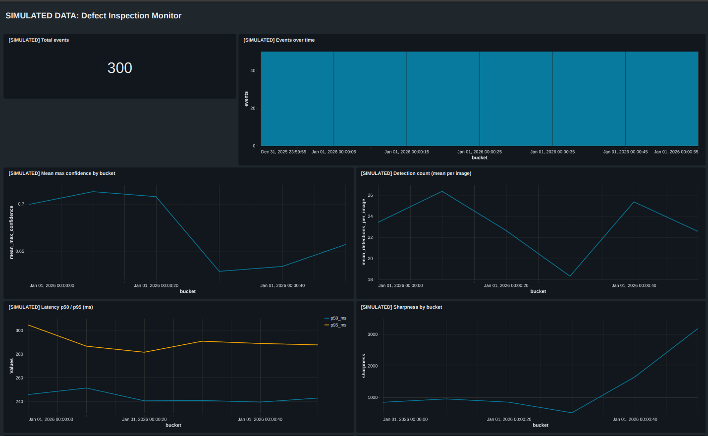
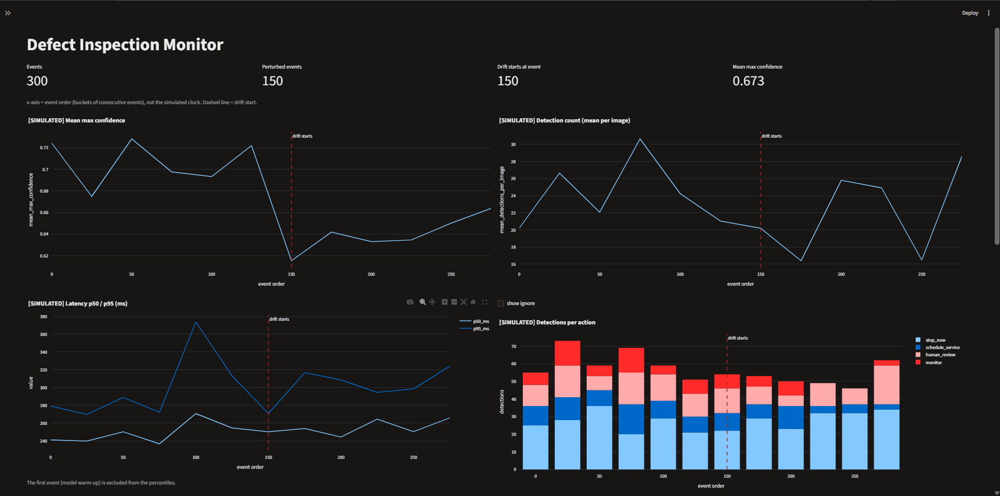

# Defect Inspection System

[](https://github.com/AaruneshAP/defect-inspection/actions/workflows/ci.yml)

An end-to-end computer vision inspection system for detecting, classifying, and acting on manufacturing surface defects in hot-rolled steel strip (using the NEU-DET benchmark). The project covers dataset preparation, YOLOv8 fine-tuning, an asymmetric cost model with pre-registered evaluation, error analysis, robustness stress-testing, containerized FastAPI serving, lakehouse telemetry with Databricks Delta Lake, two-tier drift monitoring, automated promotion gating, and a public interactive demo.

- **Live Web Demo:** <https://defect-inspection.streamlit.app/>
- **Hugging Face Model Repo:** <https://huggingface.co/Aarun-1/defect-detector-neu-det>

---

## Project Summary & Headline Findings

This project was built to test real-world ML engineering questions rather than chase benchmark tenths: does a cost-tuned decision policy beat a simple threshold? How fragile is the detector to realistic sensor corruptions? Can label-free telemetry catch performance drops before ground-truth labels arrive?

Here is what the numbers actually show:

1. **Detection Baseline (YOLOv8s on val, 216 images)**:
   - Overall val mAP50 is **0.7545** (at standard conf 0.001) / **0.668** (at operating conf 0.25).
   - Class performance is heavily skewed: scratches (0.952) and patches (0.877) are clean, while **crazing** (0.419) and **rolled-in scale** (0.622) are weak.
   - Detailed error analysis revealed that crazing's low AP50 is mostly **bounding-box localization ambiguity, not missed defects**: relaxing the IoU threshold to 0.3 raises crazing AP to 0.688 (while AP75 collapses to 0.037). Out of 84 ground-truth crazing boxes on validation, only 4 were missed outright, but 37 had IoU between 0.15 and 0.50.
2. **Decision Layer (Pre-registered on test, 360 images, 854 ground-truth defects)**:
   - Missing a defect was modeled as costing 10× a false alarm (cost: miss 10, false alarm 1, human review 0.3) with a budget constraint ($\le 3$ alerts+reviews per image).
   - We tested whether per-class confidence bands with a human-review option beat a single global threshold. **The pre-registered hypothesis was not supported**: the tuned per-class policy scored a total cost of 3052.7 vs 3041.9 for a single matched global threshold of 0.127—a relative saving of **-0.4% (95% bootstrap CI [-7.8%, +6.2%])**. The fancier policy offered no demonstrated advantage over a single flat cutoff tuned for the same workload.
   - However, tuning the threshold away from the default naive 0.25 cutoff reduced test cost by **about 22%** (3041.9 vs 3901.0).
3. **Robustness Stress-Testing (Synthetic corruptions on val)**:
   - The detector is fragile to blur (mAP drops by 0.24 to 0.53), Gaussian noise (drops by 0.20 to 0.73), and JPEG compression, but practically invariant to brightness shifts (-0.006 mAP drop).
   - Contrast shifts mildly affect mAP (-0.04) but push alert volumes around without changing ranking, demonstrating that a fixed confidence threshold is vulnerable to lighting shifts.
4. **Drift Telemetry & Two-Tier Monitoring**:
   - Streaming telemetry tracks both raw image statistics (`sharpness`, `noise_est`, `contrast_std`, `brightness_mean`) and model signals (`max_confidence`, `n_detections`).
   - Drift detection uses two-sample Kolmogorov-Smirnov tests with Holm multiple-testing correction across all 6 features. Calibrated on seed 100 and evaluated on seed 200, it achieves a clean-stream false alarm rate of **0.32 episodes per 1,000 events**.
   - A two-tier alerting scheme separates benign shifts from retrain-worthy degradation: brightness drift triggers tier 1 alerts in 99% of streams but 0% tier 2 triggers (it is harmless). Conversely, mild blur and contrast reveal the limits of label-free signals: blur 1 drops mAP by -0.24 yet never triggers tier 2, though tier 1 input alerts catch 100% of cases.
5. **Promotion Gate**:
   - Pre-committed rules ($\ge +0.010$ mAP gain, $\le 0.050$ class AP drop, paired bootstrap CI) evaluated against all Phase 2b experimental models (E1 imgsz 320, E2 YOLOv8m, E3 heavy augmentation) rejected all three against the baseline.
6. **Deployment & Parity**:
   - FastAPI + Docker serving with non-root execution and healthchecks.
   - ONNX runtime backend verified to achieve exact numerical parity with PyTorch across all 216 validation images (identical detection counts, minimum box IoU 0.99999, maximum confidence difference $6 \times 10^{-6}$).

---

## Quick Links & How to Run

- **Interactive Demo**: <https://defect-inspection.streamlit.app/> (hosted on Streamlit Community Cloud).
- **Run the Streamlit Demo Locally**:
  ```bash
  pip install -r streamlit_app/requirements.txt
  streamlit run streamlit_app/streamlit_app.py
  ```
- **Run the Monitoring Dashboard Locally**:
  ```bash
  pip install -r requirements-dashboard.txt
  streamlit run app/dashboard.py
  ```
- **Run the FastAPI Service via Docker**:
  ```bash
  docker build -t defect-inspection:latest .
  docker run -p 8000:8000 -v $(pwd)/models:/models -e MODEL_PATH=/models/best.pt defect-inspection:latest
  ```
- **Run the Hermetic Test Suite**:
  ```bash
  pytest
  ```

---

## Dataset

- **Source & Authors**: The dataset used is the **NEU Surface Defect Database (NEU-DET)**, introduced by Kechen Song and Yunhui Yan (Northeastern University, Shenyang, China) in their research on hot-rolled steel strip surface defect detection.
- **Classes**: 6 balanced surface defect categories (300 images per class, 1,800 images total at 200×200 resolution):
  1. `crazing`
  2. `inclusion`
  3. `patches`
  4. `pitted_surface`
  5. `rolled-in_scale`
  6. `scratches`
- **Licensing Notice**: On Kaggle, the dataset license is listed as **"Unknown"**. Consequently, **the raw data is not redistributed in this repository** and is strictly excluded via `.gitignore`.
- **Downloading the Data**:
  Download the dataset archive from Kaggle and place/extract it into `data/`:
  ```bash
  # Using Kaggle CLI:
  kaggle datasets download -d kaustubhdikshit/neu-surface-defect-database -p data/
  # Or place archive.zip into data/ and extract to data/archive/
  ```

---

## Phase 1: Data Preparation

Phase 1 provides complete Pascal VOC XML annotation parsing, coordinate normalization and boundary clamping, class-stratified dataset splitting, and YOLO formatting.

### Split Sizes
The provided dataset is partitioned into three strictly isolated splits:
- **Train Split (85% of provided train set)**: **1,224 images & labels** (exactly 204 images per class).
- **Validation Split (15% of provided train set)**: **216 images & labels** (exactly 36 images per class).
- **Test Split (Reserved evaluation set)**: **360 images & labels** (exactly 60 images per class, derived from the original validation partition and untouched during training or hyperparameter tuning).

### Duplicate Image Detection
An MD5 cryptographic hash audit across all 1,800 images detected **one identical duplicate image pair**:
- **Duplicate Files**: `patches_101.jpg` and `patches_105.jpg` (MD5 digest: `24f39e0f91f95e4c785052ac4d3e49a6`).
- **Leakage Prevention**: Both images reside exclusively within `images/train/`, preventing data leakage into validation or test sets.

### Running the YOLO Conversion
To convert raw Pascal VOC XML annotations to normalized YOLO format and generate `data/yolo/` with `data.yaml`:
```bash
python -c "from src.data import convert_dataset_to_yolo; convert_dataset_to_yolo(data_dir='data', output_dir='data/yolo', val_ratio=0.15, seed=42)"
```

---

## Phase 2a Results

Baseline model evaluation on the validation split (**216 images**, exactly 36 images per class) using **YOLOv8s** (`imgsz=640`, `seed=42`, trained for 50 epochs on Kaggle GPU):

### Overall Validation Performance

| Metric | Standard Evaluation (`conf=0.001`) | Operational Threshold (`conf=0.25`) |
| :--- | :--- | :--- |
| **mAP@50** | **0.755** | **0.668** |
| **mAP@50-95** | **0.430** | — |
| **Precision** | **0.725** | **0.690** |
| **Recall** | **0.713** | **0.733** |

### Per-Class mAP@50 Breakdown (Standard Evaluation, `conf=0.001`)

| Defect Class | mAP@50 | Operational Note (`conf=0.25`) |
| :--- | :--- | :--- |
| `scratches` | **0.952** | Top performer; possible explanation (untested): distinctive longitudinal aspect ratio |
| `patches` | **0.877** | High performer; possible explanation (untested): high contrast and uniform geometry |
| `pitted_surface` | **0.845** | Strong performer; possible explanation (untested): strong texture clustering and box overlap |
| `inclusion` | **0.813** | Solid localization; possible explanation (untested): small dark anomalies |
| `rolled-in_scale`| **0.622** | Weak class; possible explanation (untested): confused with background rolling grain |
| `crazing` | **0.419** | Weakest class / primary bottleneck; stays weak in both (recall 0.32 at conf=0.001 and 0.38 at conf=0.25) |

### Key Observations & Limitations
- **Confidence Threshold Effect**: At conf=0.25, overall recall is slightly higher (0.733 vs 0.713) and precision lower (0.690 vs 0.725). mAP is lower (0.668 vs 0.755) because truncating low-confidence detections shortens the precision-recall curve; the conf=0.001 figure is the standard mAP. Crazing stays weak in both (recall 0.32 and 0.38).
- **Weak Classes**: `crazing` (0.419 mAP50) and `rolled-in_scale` (0.622 mAP50) represent the primary detection bottlenecks.
- **Sample Size Limitation**: The validation split contains only **36 images per class** (216 images total), meaning single misclassifications carry noticeable percentage weight.
- **Single Seed**: Results reflect a single deterministic run (`seed=42`).
- **Confusion Matrix Note**: We do not use the Ultralytics confusion matrix for conclusions.

---

## Phase 2b Results

Controlled ablation experiments to improve performance on weak defect classes (`crazing` and `rolled-in_scale`), evaluated strictly on the validation split (**216 images**, exactly 36 images per class, `seed=42`, 50 epochs on Kaggle GPU):

| experiment | model | imgsz | epochs | precision | recall | mAP50 | mAP50-95 | crazing_AP50 | inclusion_AP50 | patches_AP50 | pitted_surface_AP50 | rolled-in_scale_AP50 | scratches_AP50 |
| :--- | :--- | :--- | :--- | :--- | :--- | :--- | :--- | :--- | :--- | :--- | :--- | :--- | :--- |
| e0_baseline | yolov8s.pt | 640 | 50 | 0.7248 | 0.7134 | 0.7545 | 0.4301 | 0.4189 | 0.8132 | 0.8772 | 0.8446 | 0.6215 | 0.9517 |
| e1_imgsz320 | yolov8s.pt | 320 | 50 | 0.6999 | 0.7372 | 0.7578 | 0.43 | 0.4311 | 0.8209 | 0.8884 | 0.8639 | 0.632 | 0.9104 |
| e2_yolov8m_640 | yolov8m.pt | 640 | 50 | 0.6593 | 0.7227 | 0.7404 | 0.4375 | 0.3262 | 0.8208 | 0.8896 | 0.8441 | 0.6311 | 0.9305 |
| e3_augmented | yolov8s.pt | 640 | 50 | 0.7058 | 0.6594 | 0.7261 | 0.4068 | 0.3397 | 0.8202 | 0.8642 | 0.8419 | 0.5941 | 0.8965 |

### Summary & Honest Empirical Analysis
- **No Clear Improvement Over Baseline**: None of the interventions showed a clear improvement over the E0 baseline (0.755 mAP50).
- **E1 (320×320) Matched the Baseline Within Noise at Lower Cost**: E1 achieved 0.758 mAP50 with 4× smaller pixel processing cost, matching the baseline within noise; a possible explanation (untested) is that downsampling closer to the native 200×200 source resolution preserves feature quality without upsampling blur.
- **Larger Model and Augmentation Bundle Did Not Help**: E2 (YOLOv8m, 25.9M params) dropped crazing AP50 to 0.326; a possible explanation (untested) is overfitting on 1,224 training images. E3 (crazing AP50 0.340, rolled-in scale 0.594) did not improve performance; a possible explanation (untested) is that heavy spatial and photometric augmentations (rotation, scale jitter, HSV shifts) may degrade subtle texture cues.
- **Crazing Bottleneck Persists (0.33–0.43 AP50)**: Crazing stayed at 0.33–0.43 in every single run; a possible explanation (untested) is an underlying data or labeling limit (such as faint contrast, ambiguous boundary annotations, or label noise) to be checked in error analysis.
- **Exact Reproducibility**: E0 reproduced Phase 2a exactly (0.7545 mAP50, 0.4301 mAP50-95, 0.4189 crazing AP50).
- **Statistical Context**: Results come from a single deterministic seed (`seed=42`) with only 36 images per class in validation, so small metric gaps are noise.


---

## Phase 3: Decision Layer

Phase 3 implements an operational decision layer that maps raw bounding box detections to factory actions through an explicit cost model, severity scoring, per-class threshold calibration, and optional human-in-the-loop review bands. The entire evaluation protocol was pre-registered prior to running inference on the reserved test split.

### Decision Layer Design

1. **Cost Model Formulation**:
   - Total industrial cost evaluates missed flaws, false alarms, and inspection overhead:
     $$\text{Total Cost} = \sum_{\text{missed defects}} (\text{cost\_miss} \times \text{severity}) + \sum_{\text{false alarms}} \text{cost\_false\_alarm} + \sum_{\text{reviewed boxes}} \text{cost\_review}$$
   - **Baseline Cost Weights** (`configs/cost.yaml`): $\text{cost\_miss} = 10$, $\text{cost\_false\_alarm} = 1$, $\text{cost\_review} = 0.3$.
   - **Matching Protocol**: Class-aware greedy matching at $\text{IoU} \ge 0.5$, sorted by confidence descending. Duplicate detections matching an already-claimed ground truth count as false alarms.
2. **Severity-to-Action Mapping**:
   - Defect severity is computed as $\text{severity} = \text{class\_weight} \times \text{area\_factor}$, where area factor scales linearly with box area fraction from $0.4$ (small defect, $\le 2\%$ image area) to $2.0$ (large defect, $\ge 20\%$ image area).
   - If detection confidence falls in a review band, action is `human_review`.
   - If detection confidence meets the alert threshold, severity triggers automated factory responses:
     - $\text{severity} < 0.5$: `ignore` (minor surface blemish)
     - $0.5 \le \text{severity} < 0.8$: `monitor` (log defect trend)
     - $0.8 \le \text{severity} < 1.3$: `schedule_service` (flag roll inspection)
     - $\text{severity} \ge 1.3$: `stop_now` (immediate line emergency halt)
3. **Optional Review Band & Workload Budget**:
   - Per-class confidence band $[\text{lower}, \text{upper})$: detections with $\text{conf} \ge \text{upper}$ alert directly; $\text{lower} \le \text{conf} < \text{upper}$ route to a human inspector; $\text{conf} < \text{lower}$ are ignored.
   - Reviewer accuracy $a$: symmetric model where a human reviewer correctly verifies defects with probability $a$ ($a=0.9$ primary, $a=1.0$ and $a=0.8$ secondary).
   - Workload constraint: average inspection budget $B \le 3$ (combined alerts + reviews per image $\le 3$ on validation set).

### Pre-Registered Primary Outcome (Not Supported on Val and Test)

Prior to running on the test set (`reports/phase3/preregistration.md`), we pre-registered the primary hypothesis: *a tuned per-class review band policy ($a=0.9, B \le 3$) delivers statistically significant cost savings over a matched flat alerting baseline ($0.127$).* The pre-registered success criterion required the 95% bootstrap confidence interval of cost saving to lie strictly above zero.

- **Validation Split (216 images)**:
  - Primary policy cost: **1610.7** vs matched flat cost: **1688.1**.
  - Cost saving: **77.4** (**4.6%**), but 95% bootstrap CI was **`[-33.7, 194.3]`** (percentage CI **`[-2.1%, 11.1%]`**).
  - *Result*: The interval crosses zero (lower bound **−33.7**), so the primary outcome was **not supported on validation**.
- **Test Split (360 images, 854 ground truth defects)**:
  - Primary policy cost: **3052.7** (cost/image **8.480** `[7.321, 9.709]`, recall **0.760** `[0.731, 0.788]`, alerts/image **2.525**, reviews/image **0.833**).
  - Matched flat (0.127) cost: **3041.9** (cost/image **8.450** `[7.248, 9.670]`, recall **0.785** `[0.756, 0.812]`, alerts/image **3.400**, reviews/image **0.000**).
  - Cost saving vs matched flat: **−10.8** (**−0.4%**, 95% CI **`[-225.7, 193.3]`**, percentage CI **`[-7.8%, 6.2%]`**).
  - *Result*: The primary outcome was **not supported on test**; the matched flat baseline achieved slightly lower total cost, and the difference is well within statistical noise.

### Test Split Results Table (360 Images)

| Policy | Total Cost | Cost / Image (95% CI) | Recall (95% CI) | Alerts / Img | Reviews / Img | Saving vs Flat 0.25 (%) | Saving vs Matched Flat (%) |
| :--- | :--- | :--- | :--- | :--- | :--- | :--- | :--- |
| `primary (a=0.9, B<=3)` | **3052.7** | 8.480 [7.321, 9.709] | 0.760 [0.731, 0.788] | 2.525 | 0.833 | **857.9** (21.9% [15.7, 27.8]) | **-10.8** (-0.4% [-7.8, 6.2]) |
| `matched flat (0.127)` | **3041.9** | 8.450 [7.248, 9.670] | 0.785 [0.756, 0.812] | 3.400 | 0.000 | **868.7** (22.2% [16.1, 28.2]) | **0.0** (reference) |
| `secondary a=1.0` | **2791.3** | 7.754 [6.631, 8.948] | 0.767 [0.738, 0.795] | 1.436 | 1.922 | **1119.3** (28.6% [22.1, 34.9]) | **250.6** (8.2% [1.0, 14.9]) |
| `secondary a=0.8` | **3065.7** | 8.516 [7.344, 9.754] | 0.766 [0.737, 0.795] | 3.294 | 0.064 | **844.9** (21.6% [14.7, 28.1]) | **-23.8** (-0.8% [-8.3, 6.0]) |
| `flat 0.25` | **3910.6** | 10.863 [9.363, 12.399] | 0.700 [0.665, 0.735] | 2.425 | 0.000 | **0.0** (reference) | **-868.7** (-28.6% [-39.3, -19.1]) |
| `no alerts` | **11549.4** | 32.082 [30.540, 33.607] | 0.000 [0.000, 0.000] | 0.000 | 0.000 | **-7638.8** (-195.3%) | **-8507.5** (-279.7%) |

### Main Finding

1. **Cost-Tuned Thresholds Beat Default 0.25 by ~22%**:
   - Aligning detection thresholds with asymmetric factory costs (where missing a defect costs 10× a false alarm) produced a substantial **21.9% to 22.2% cost reduction** on the test set compared to the standard `0.25` threshold (saving **857.9** to **868.7** cost units).
2. **A Single Matched Global Threshold Matches Complex Policies**:
   - A single global threshold of **`0.127`** (matched on validation alert workload) achieved a total test cost of **3041.9**, matching the primary per-class review-band policy (**3052.7**) within noise.
   - **Practical Takeaway**: In this industrial inspection setting, optimizing a single operating point captures all economic benefits without the operational friction, latency, and maintenance burden of per-class review bands.

### Secondary Result & Caveats

- **Infallible Reviewer Scenario ($a=1.0$)**:
  - If human review is assumed to be 100% accurate ($a=1.0$), the policy achieves a test cost of **2791.3**, saving **250.6** (**8.2%**, 95% CI `[28.5, 465.2]`, `[1.0%, 14.9%]`) over matched flat alerting.
- **Caveats**:
  - This benefit is brittle and depends entirely on the unrealistic assumption of perfect human inspection ($a=1.0$).
  - Once human error is modeled ($a=0.9$), the advantage drops to **−0.4%** (`[-7.8%, 6.2%]`).
  - At $a=0.8$, the policy barely utilizes review (only **0.064** reviews/image, test cost **3065.7**, saving **−0.8%**, 95% CI `[-8.3%, 6.0%]`) because human errors incur expensive false alarm and miss penalties that outweigh the review band's utility.

### Sensitivity Summary

A 24-condition grid sweep across miss-to-false-alarm cost ratios (2, 3, 5, 10, 20, 50) and review costs (0.1, 0.3, 0.6, 1.0) on validation revealed:
Review bands help significantly only when review cost is ≤ 0.3 with a miss-to-false-alarm ratio ≤ 5, or review cost 0.1 at ratio 10; at ratios ≥ 20 or review cost ≥ 0.6 the savings are not distinguishable from zero.

### Methodological Limitations

1. **Illustrative Cost Parameters**: Costs (10 miss / 1 false alarm / 0.3 review) are illustrative engineering benchmarks rather than site-specific plant accounting data.
2. **Absence of Defect-Free Images**: Every image in the NEU-DET database contains at least one defect. False alarm rates on pristine, flaw-free steel sheets cannot be measured on this dataset.
3. **Prior Validation Split Exposure**: The validation set was utilized in Phase 2 for baseline verification and experimental comparison prior to Phase 3 threshold tuning.
4. **Single Test Evaluation**: The test set (360 images) was strictly held out and evaluated exactly once using frozen pre-registered thresholds without retuning.

---

## Phase 4: Error Analysis and Robustness

Phase 4 diagnoses the primary failure modes on the validation split (e0 baseline, single global confidence threshold 0.127) through detailed error categorisation, IoU sensitivity sweeps, and synthetic perturbation stress tests.

### 1. Defect Error Analysis (Val Split, Threshold 0.127)

- **Crazing Bottleneck & Bounding Box Ambiguity**:
  - Evaluation of the 84 ground truth crazing boxes on validation: **43 matched (TP)**, **37 poorly localized** (best same-class IoU between 0.15 and 0.50, median 0.34), **4 missed** (no kept detection with IoU > 0.1), and **0 wrong-class** confusions.
  - Across IoU evaluation thresholds, crazing AP drops steeply: **AP30 is 0.688**, **AP50 is 0.425**, and **AP75 collapses to 0.04** (0.037).
  - Ground truth crazing boxes are large (median area fraction 0.20) and frequently overlap sibling annotations in the same image (33.3% overlap rate). This behavior is **consistent with box ambiguity**: the detector consistently locates the crazing areas, but bounding rectangular boundaries on sprawling, diffuse micro-crack networks are inherently subjective.
  - Annotation noise and model weakness cannot be separated with one annotator and no repeat labels.
- **Inclusion False Alarms**:
  - Out of 187 inclusion detections at threshold 0.127, 50 detections (**about 27%**, 26.7%) are true background false alarms (IoU < 0.1 with any ground truth defect). This is the highest background false alarm share of any defect class.

### 2. Synthetic Perturbation Robustness (Val Split, One Model)

We evaluated baseline model stability under 5 synthetic perturbation families (Gaussian blur, Gaussian noise, JPEG compression, brightness, and contrast) on all 216 validation images:
- **Evaluation Settings**: mAP50 uses all detections down to confidence floor 0.001. Recall and alerts per image use the operational 0.127 threshold.
- **Clean Baseline Note**: Clean mAP50 is **0.760** (0.7599) in this single-image evaluation pipeline versus **0.7545** from Ultralytics `model.val` in Phase 2a. The 0.004 gap is unexplained and small (batched val letterboxing differences vs single-image predict, plus 494 vs 495 ground truth boxes parsed), and all robustness deltas are measured against the same cached clean run.
- **Fragile to Blur, Noise, and JPEG**:
  - The model degrades under Gaussian blur ($\Delta \text{mAP50} = -0.236$ at $\sigma=1.0$, 95% CI `[-0.274, -0.195]`), additive noise ($\Delta \text{mAP50} = -0.203$ at $\sigma=0.02$, 95% CI `[-0.245, -0.154]`), and JPEG compression ($\Delta \text{mAP50} = -0.124$ at quality 50, 95% CI `[-0.154, -0.086]`). All paired bootstrap confidence intervals are strictly away from zero.
- **Robust to Brightness**:
  - The detector is robust to overall illumination shifts ($0.6\times$ to $1.4\times$ brightness), with mAP50 deltas of only $-0.003$ to $-0.014$, all with confidence intervals crossing zero.
- **Contrast Shifts & Threshold Instability**:
  - At contrast 1.4, mAP50 drop is small ($-0.025$, 95% CI `[-0.041, -0.008]`), but operational alerts increase by **+0.4 alerts per image** (3.38 vs 2.99 clean, $\Delta = +0.389$, 95% CI `[+0.264, +0.514]`) with no recall gain ($0.794$ vs $0.782$, $\Delta = +0.012$, 95% CI `[-0.009, 0.033]`, crossing zero).
  - The mAP50 drop is small but recall and alerts move, which suggests confidences crossing the fixed threshold and not worse ranking. A fixed threshold is not stable under these shifts.

### 3. Matching IoU Sensitivity (Exploratory, Val Only)

- When the matching threshold is lowered from IoU 0.5 to IoU 0.3 on validation, matched flat recall rises from **0.780** (`[0.739, 0.820]`) to **0.883** (`[0.851, 0.914]`).
- The optimal flat threshold barely moves (**0.127** at IoU 0.5 vs **0.128** at IoU 0.3) because the alert budget ($B \le 3$ alerts/image) sets it.
- The shipped policy and Phase 3 test results are unchanged.

---

## Phase 5: Reproducible, Tracked, Containerized

Phase 5 establishes reproducible environments, experiment tracking, model registry management, automated CI workflows, and a containerized line-side FastAPI inference microservice:

### 1. Reproducible Environment & CI Pipeline
- **Environment Automation**: Defined via `scripts/setup.ps1` and virtual environment setup with pinned top-level dependencies in `requirements.txt` and developer tooling in `requirements-dev.txt`.
- **Hermetic CI Execution**: GitHub Actions workflow (`.github/workflows/ci.yml`) executes Ruff linting and the Pytest test suite across all modules on Python 3.13. Data-dependent tests requiring local git-ignored assets (`data/yolo`, `data/cache/`, `models/best.pt`) are automatically skipped in CI via `tests/conftest.py` hooks without masking failures in discovery or business logic.

### 2. MLflow Tracking & Model Registry
- **Tracking Store**: Configured using a local file store backend (`src/tracking.py` and `docs/tracking.md`).
- **Historical Backfill**: Historical Phase 2b controlled experiments (E0–E3) and Phase 3 policy evaluation results were backfilled into MLflow runs (`scripts/backfill_mlflow.py`) with full hyperparameter logs, evaluation metrics, and artifact tracking (`comparison.csv`, figures, policy configs).
- **Provenance & Limitations**: The recorded `git_commit` tag reflects the commit that recorded the experiment results. The Phase 3 bootstrap seed is unrecorded. The baseline weights were registered into the MLflow model registry under alias `@production` (and `@champion`).

### 3. FastAPI Service & Docker Containerization
- **REST Inspection API**: FastAPI application (`app/main.py`, `app/service.py`) exposing `/health`, `/model-info`, and `/predict`.
  - `/predict` processes multipart image uploads (1..8 images), applies the frozen Phase 3 decision policy (`reports/phase3/frozen.json`), and returns individual defect bounding boxes, severities, and recommended actions.
  - By default, `/predict` omits detections whose action is `ignore`. An optional query parameter `include_ignored=true` returns all detections down to the confidence floor while keeping the rolled-up per-image `decision` identical.
- **Docker Packaging**: Containerized via multi-stage CPU-only `Dockerfile` (`python:3.13-slim`, CPU PyTorch, headless OpenCV `5.0.0.93`, non-root user `uid 10001`, and built-in Docker `HEALTHCHECK`).
- **Local Verification (Docker Desktop)**: Verified container runs healthy, operates as non-root user `appuser` (`uid 10001`), mounts `models/best.pt` read-only at runtime, matches model version `sha256:dff41d9a7f7b`, and successfully processes real validation images (`crazing_107.jpg` and `scratches_1.jpg`).
- **CI Verification**: GitHub Actions validates container image building and runs a no-weights smoke test verifying that `/health` reports `status: ok` and `/predict` returns HTTP 503.

### 4. Honest Limitations & Design Choices
- **Decision Roll-up**: The per-image decision roll-up ("most urgent detection wins": `stop_now` > `schedule_service` > `human_review` > `monitor` > `ignore`) is a design choice that has not been evaluated; Phase 3 evaluated per-detection cost only.
- **DVC Deferred**: DVC data versioning is deferred because the NEU-DET dataset is not redistributable under its unknown license, and the model artifact is a single static weights file (`models/best.pt`).
- **Local File Store**: MLflow uses a local file store (`mlruns/`) rather than a remote server until cloud migration (e.g., Databricks).
- **Dependency Pinning**: Only top-level dependencies are pinned in `requirements.txt`; the containerized production image enforces a frozen `constraints.txt` file (with Windows-only dependencies removed).

---

## Phase 6: Simulated Inspection Stream and Monitoring

Phase 6 implements an end-to-end telemetry and monitoring pipeline for line-side defect inspection, including a traffic simulator with controlled drift injection, multi-sink event logging (Parquet, SQLite, Delta Lake), an AI/BI Lakeview dashboard on Databricks, and a lightweight standalone Streamlit monitoring application.


*Figure: Databricks AI/BI Lakeview monitoring dashboard over the Delta Lake inspection event stream.*


*Figure: Streamlit monitoring application displaying simulated inspection traffic and input statistics.*

### 1. Telemetry Architecture, Event Schema & Sinks
- **Canonical Event Schema (`src/inspection_log.py`)**:
  - Each inspection produces a structured record (`InspectionEvent`): `event_id`, `timestamp` (UTC), `image_id`, `model_version`, `n_detections`, `worst_decision` (`stop_now`, `schedule_service`, `human_review`, `monitor`, `ignore`), `max_confidence`, per-action detection counts (`n_stop_now`, `n_schedule_service`, `n_human_review`, `n_monitor`, `n_ignore`), `latency_ms`, `perturbation`, `severity`, `simulated`, and Schema v2 input image statistics (`brightness_mean`, `contrast_std`, `sharpness`, `noise_est`).
- **Pluggable Sinks (`Sink` Protocol)**:
  - **ParquetSink**: Local partitioned Parquet files (`data/inspection/sim.parquet/part-*.parquet`).
  - **SQLiteSink**: Local relational SQLite database (`data/inspection/sim.sqlite`).
  - **DeltaSink**: Databricks Unity Catalog / Delta Lake table (`defect_inspection.inspection_events`) via `databricks-sql-connector`. Writes are idempotent by `event_id` via SQL `MERGE ... WHEN NOT MATCHED`, batched into parameterized statements.
  - A committed sample snapshot (`data/sample/inspection_sample.parquet`, 300 simulated events) allows testing and local dashboard usage out-of-the-box.
- **Inspection Stream Simulator (`src/simulator.py`)**:
  - Replays validation images (refuses the spent test split) at a configurable simulated clock rate (`--rate`, default 5.0 Hz).
  - Can call the in-process `InspectionService` (`ServiceBackend`) or post multipart images over HTTP (`HttpBackend`).
  - **Drift Schedule (`DriftSchedule`)**: Simulates operational drift starting at a designated event index (`--drift-start 150`, ramp over 100 events). Randomly injects synthetic perturbations (blur, Gaussian noise, contrast variations) at escalating severity levels to evaluate detector degradation and telemetry responsiveness.

### 2. Monitoring Dashboards & Running Streamlit
- **Databricks AI/BI Lakeview Dashboard**:
  - Defined declaratively in `sql/dashboard_queries.sql` and managed programmatically via Databricks SDK in `scripts/create_dashboard.py`.
  - Creates, updates, and publishes the dashboard with parameterized time bucketing (`:bucket_seconds`).
  - Displays KPI counters, event volumes, mean max confidence, mean detection counts, p50/p95 latency percentiles, decision distributions, and input image statistics.
- **Streamlit Monitoring Application (`app/dashboard.py`)**:
  - Standalone monitoring UI built with pure Pandas and Plotly (`src/dashboard_data.py`), with no runtime dependency on PyTorch or Ultralytics.
  - Supports three data sources:
    1. **Sample snapshot** (`data/sample/inspection_sample.parquet`): Zero-setup evaluation mode.
    2. **Local file**: Direct ingestion of local Parquet or SQLite sink outputs.
    3. **Delta (Databricks)**: Live query against `defect_inspection.inspection_events` using credentials in a git-ignored `.env`.
- **How to Run the Streamlit Dashboard**:
  ```bash
  # Install dashboard dependencies (lightweight, no torch/ultralytics)
  pip install -r requirements-dashboard.txt

  # Launch the Streamlit dashboard
  streamlit run app/dashboard.py
  ```

### 3. Empirical Findings: Telemetry Under Drift
Replaying 300 validation images (150 clean followed by 150 drifted across blur, Gaussian noise, and contrast) revealed clear telemetry patterns:
- **Sharpness Collapse Under Blur**:
  - Clean validation images exhibit high baseline sharpness ($\approx 880$ variance of Laplacian). Gaussian blur causes sharpness to plummet to $7.7$ (a $>99\%$ drop), providing an immediate, unambiguous camera defocus or smudge indicator.
- **Noise Estimate Spikes**:
  - Clean hot-rolled steel grain produces a high baseline noise estimate ($\text{noise\_est} \approx 22.7$, scaled median absolute deviation of Laplacian). Sensor noise sharply elevates this estimate to $60.0$ ($+164\%$).
  - Notably, sensor noise also inflates measured sharpness ($\approx 4,265$) because the Laplacian variance responds to high-frequency pixel artifacts as edge energy.
- **Contrast Shifts**:
  - Contrast perturbations shift `contrast_std` in a level-dependent manner (mean $32.1$ vs $28.8$ clean).
- **Max Confidence Misses Contrast Drift**:
  - While mean maximum confidence drops noticeably under severe blur ($0.707 \rightarrow 0.570$) and noise ($0.707 \rightarrow 0.626$), it fails to detect contrast drift ($0.723$ vs $0.707$ clean).
  - This demonstrates that **output-confidence monitoring alone is blind to lighting/contrast shifts**, underscoring the necessity of tracking raw input image statistics alongside model predictions.

### 4. Honest Limitations & Design Boundaries
- **Simulated Stream & Injected Drift**:
  - All streaming data and perturbations are generated synthetically by the simulator (`simulated = TRUE`). Detecting these shifts confirms that the logging pipeline and statistical metrics function correctly, not that real-world steel mill environmental drift is automatically detected.
- **Class Skew & Roll-up Heuristic**:
  - The NEU-DET dataset consists exclusively of defective steel coupons (no defect-free benign production images). Consequently, $\approx 78\text{--}80\%$ of inspected images produce a rolled-up decision of `stop_now`. The per-image roll-up heuristic ("most urgent action wins") remains unevaluated against factory operational costs.
- **Texture Baselines**:
  - `noise_est` has a high clean baseline ($\approx 22.7$) due to hot-rolled steel surface textures, and Gaussian noise also elevates Laplacian sharpness.
- **Dashboard Accessibility**:
  - The Databricks Lakeview dashboard is hosted within the private workspace and requires workspace permissions. The committed dashboard screenshots and the local Streamlit application serve as the public, portable views.
- **Credential Protection**:
  - Databricks connection parameters (`DATABRICKS_SERVER_HOSTNAME`, `DATABRICKS_HTTP_PATH`, `DATABRICKS_TOKEN`) are loaded from a git-ignored `.env` file (based on `.env.example`). The token is strictly scrubbed from connection error logs and never committed.

---

## Phase 7: Monitoring, Retrain Gate, and the Live Demo

Phase 7 completes the production lifecycle: continuous drift detection with statistical multiple-testing correction, a two-tier operational alert system separating benign shifts from retrain-worthy failures, an automated model promotion gate, an ONNX runtime backend verified against PyTorch, and a public interactive web demo.

### 1. Drift Detection & Statistical Testing
To detect distribution shifts without ground-truth inspection labels, we monitor six streaming features:
- **Raw Input Image Statistics**: `brightness_mean`, `contrast_std`, `sharpness` (variance of Laplacian), and `noise_est` (scaled median absolute deviation of Laplacian).
- **Model Output Signals**: `max_confidence` and `n_detections`.

**Statistical Framework (`src/drift.py`)**:
- Compares a sliding window of recent traffic ($W = 30$ events) against a fixed clean reference window ($N = 200$ events) using two-sample **Kolmogorov-Smirnov (KS) tests**.
- **Multiple Testing Control**: Testing 6 features simultaneously inflates false alarm rates. We apply the step-down **Holm-Bonferroni correction** to bound the Family-Wise Error Rate (FWER) at target significance $\alpha = 0.001$.
- **Calibration & Holdout Evaluation**:
  - Detection thresholds were calibrated on a synthetic stream with seed 100 and evaluated on a separate holdout stream with seed 200.
  - On clean simulated traffic (20 independent streams, 15,420 sliding windows evaluated), the system achieved a low false alarm rate of **0.32 episodes per 1,000 events** (per-window false alarm rate: $0.0011$; 85% of clean streams completed without any false alarm).
- **Detection Delays & Feature Responsiveness**:
  - **Gaussian Blur**: Detected rapidly with a median delay of 16.5 events at mild blur ($\sigma = 1.0$) and 12.0 events at moderate/severe blur ($\sigma \in \{2.0, 3.0\}$; 90th percentile delay $\le 20$ events). Sharpness and noise estimate flag on 100% of windows. At severe blur, `max_confidence` also drops and flags on 87% of windows.
  - **Gaussian Noise**: Detected in 25.0 events (mild $\sigma = 0.02$), 14.5 events (moderate $\sigma = 0.05$), and 11.0 events (severe $\sigma = 0.10$; 90th percentile delay $\le 42.2$ events). Sharpness and noise estimate fire immediately, while confidence collapses and detection counts plummet.
  - **Contrast Shifts**: Detected with median delays of 26.0 events (mild $0.6\times$) and 50.0 events (severe $1.4\times$), driven by `contrast_std`.
  - **Brightness Shifts**: Detected with median delays between 18.0 and 89.0 events across levels ($0.6\times$ to $1.4\times$), driven by `brightness_mean`.

---

### 2. Two-Tier Alerting & Empirical Findings
Alert fatigue is a critical failure mode in industrial monitoring. If every lighting flicker pages an on-call engineer, alerts get silenced. We implemented a two-tier alerting policy (`src/triggers.py`):
- **Tier 1 (Telemetry Alert)**: Informational alert indicating input sensor drift (fires when at least one input statistic passes the Holm-adjusted KS threshold). It signals camera issues (smudge, defocus, lighting fluctuation) without claiming the model is broken.
- **Tier 2 (Retrain Recommended)**: High-severity trigger indicating both input drift and model output degradation ($k_1 \ge 1$ input features and prediction drift occurring within a rolling buffer of $m = 10$ windows).

```text
[Input Stream] ──> [Feature Extraction] ──> [Holm KS Test]
                           │
       ┌───────────────────┴───────────────────┐
       ▼                                       ▼
Input Statistic Drifts?               Prediction Statistic Drifts?
(`sharpness`, `noise_est`, etc.)       (`max_confidence`, `n_detections`)
       │                                       │
       ├─ Yes ──> [Tier 1: Telemetry Alert]    │
       │          (Check camera/lighting)      │
       │                                       │
       └──────────────┬────────────────────────┘
                      ▼ Both within m=10 windows?
             [Tier 2: Retrain Trigger]
             (Model degradation suspected)
```

**Key Empirical Findings (`reports/phase7/triggers_summary.json`)**:
1. **Brightness Drift is Harmless**: Brightness shifts ($0.6\times$ to $1.4\times$) trigger Tier 1 alerts in 99% of streams, but produce **0.0% Tier 2 triggers** across all 4 evaluated severities. Because the detector is invariant to brightness ($\Delta\text{mAP50} \le -0.014$), the two-tier filter successfully prevents false retrain alerts for benign optical shifts.
2. **Limits of Label-Free Degradation Detection**:
   - Mild blur ($\sigma = 1.0$) causes a large drop of **$-0.236$ mAP50**, yet triggers Tier 2 on **0.0% of streams** because confidence scores and detection counts do not shift enough to cross the Holm threshold.
   - Moderate blur ($\sigma = 2.0$) drops mAP50 by **$-0.432$**, but triggers Tier 2 on only 50% of streams (median delay: 117 events).
   - Contrast variations drop mAP50 mildly ($-0.043$ and $-0.025$) and trigger Tier 2 on only 30% and 13% of streams.
   - **Conclusion**: Label-free prediction signals cannot reliably detect all model accuracy drops. However, **Tier 1 input alerts caught 100% of these corrupted streams**, demonstrating that monitoring raw sensor telemetry is essential when ground-truth labels are absent.
3. **Multi-Feature Sensitivity Analysis**: An exploratory post-hoc check requiring at least 2 input features to flag ($k_1 = 2$) eliminated clean false alarms entirely (0.0 episodes/1,000 events) and reduced brightness alerts to 47%, but increased detection delays across all conditions. This is reported as an exploratory sensitivity analysis, not a production re-tuning.

---

### 3. Model Promotion Gate
To prevent deploying worse or regressed models, candidate checkpoints are evaluated by an automated promotion gate (`src/promotion.py` using `configs/promotion.yaml`) before deployment.

**Pre-Registered Promotion Rules**:
1. **Minimum Overall Gain**: Must improve validation $\text{mAP50}$ by at least $+0.0100$ ($+1.0$ percentage point).
2. **Maximum Per-Class Regression**: No individual defect class may drop by more than $0.0500$ ($5.0$ percentage points in $\text{AP50}$).
3. **Paired Bootstrap Confidence Interval**: The 95% paired bootstrap confidence interval for $\Delta\text{mAP50}$ must strictly exclude zero.

**Evaluation on Phase 2b Candidates against Baseline E0 (`reports/phase7/promotion_demo.json`)**:
- **E1 (Lower Resolution, `imgsz=320`)**: **REJECTED**. Overall $\text{mAP50}$ gain was only $+0.0033$, falling short of the required $+0.0100$ threshold.
- **E2 (Larger Backbone, `yolov8m-640`)**: **REJECTED**. Overall $\text{mAP50}$ dropped by $-0.0141$, and `crazing` $\text{AP50}$ collapsed by $0.0927$ (violating the $0.05$ class degradation limit).
- **E3 (Aggressive Augmentation)**: **REJECTED**. Overall $\text{mAP50}$ dropped by $-0.0284$, with `crazing` dropping by $0.0792$ and `scratches` dropping by $0.0552$.
- *Caveat*: The paired bootstrap CI rule could not be evaluated because Phase 2b runs only stored aggregated validation metrics, not per-image detection arrays.

---

### 4. ONNX Export and Numerical Parity
For lightweight, production-grade serving without PyTorch dependencies, the model was exported to ONNX format (`models/best.onnx`, opset 17, dynamic batch size, fixed 640×640 input) and wrapped with letterbox preprocessing in `src/onnx_detector.py`.

**Validation Split Parity Audit (`reports/phase7/onnx_parity.json`)**:
We evaluated all 216 validation-split images across three operating confidence cutoffs ($0.001$, $0.127$, and $0.250$):
- **Detection Count Parity**: Exactly 216 / 216 images had identical detection counts between PyTorch and ONNX (5,411 detections at conf 0.001; 645 at 0.127; 490 at 0.250). Zero unmatched detections.
- **Bounding Box IoU**: The minimum bounding-box IoU across all matched detections was **0.99999** ($0.999988$ at conf 0.001; median IoU $> 0.999999$).
- **Confidence Discrepancy**: The maximum absolute confidence difference across all detections was **$6.14 \times 10^{-6}$** ($\le 6 \times 10^{-6}$; median difference $\approx 3.0 \times 10^{-8}$).
- **Inference Speed**: On CPU, ONNX Runtime reduced median per-image latency from $374.4\text{ ms}$ (PyTorch) to $308.5\text{ ms}$ (ONNX), roughly a 17–20% speedup.
- *Scope Note*: Parity was verified on square 200×200 validation images; non-square aspect ratios rely on letterbox padding.

---

### 5. Interactive Web Demo & Artifact Sync
- **Hosted Public Demo**: <https://defect-inspection.streamlit.app/> (deployed on Streamlit Community Cloud).
  - Page 1 (**Try it**): Upload any steel surface image or pick a validation sample to see bounding boxes color-coded by action, tabular detection details, and the per-image decision under the frozen Phase 3 policy.
  - Page 2 (**Monitoring**): Live telemetry viewer over simulated inspection streams with injected sensor drift.
- **Hugging Face Model Repository**: <https://huggingface.co/Aarun-1/defect-detector-neu-det>.
  - Hosts `best.pt`, `best.onnx`, `MODEL_CARD.md`, frozen policy configs (`policy/frozen.json`, `policy/cost.yaml`), and validation sample images.
  - *Deployment Note*: A Hugging Face Space could not be deployed because Hugging Face now requires a paid PRO subscription for Gradio Spaces on free accounts. The public demo was deployed to Streamlit Community Cloud instead, which pulls the ONNX weights directly from the HF model repository.
- **Model Sync Script**: `scripts/upload_model_repo.py` manages automated staging and uploading of weights, ONNX exports, model card documentation, and validation examples to Hugging Face.

---

### 6. Honest Limitations & Real-World Boundaries
- **Synthetic Drift**: All drift experiments were simulated by abruptly injecting mathematical perturbations (Gaussian blur, Gaussian noise, contrast scaling). Real steel mill environmental drift is gradual, seasonal, and involves multi-source corruptions.
- **Semi-Manual Retrain Loop**: The "retrain recommended" trigger alerts operators, but retraining requires collecting new imagery, manual defect labeling, and GPU compute. No automated retraining pipeline was executed.
- **No Production Validation**: The entire system was trained and evaluated on a single lab dataset (NEU-DET). It has never seen production steel strip, differing camera resolutions, or factory lighting.
- **Domain Specificity**: The model and demo are trained strictly on grayscale hot-rolled steel surface textures. Uploading general scenes or non-steel objects will produce meaningless detections.
- **Free Cloud Infrastructure**: The public demo is hosted on Streamlit Community Cloud and may sleep when idle. First cold-start requests may experience a short delay while pulling the ONNX weights.

---

## Architecture & Directory Structure

```text
defect-inspection/
├── .github/
│   └── workflows/ci.yml       # GitHub Actions CI workflow (Ruff, Pytest, Docker build & smoke test)
├── app/                       # FastAPI application and telemetry dashboard
│   ├── main.py                # REST endpoints (/health, /model-info, /predict)
│   ├── service.py             # Inference pipeline with pluggable PyTorch and ONNX backends
│   ├── schemas.py             # Pydantic schemas for detections and decisions
│   ├── dashboard.py           # Streamlit telemetry viewer (Parquet, SQLite, Delta sources)
│   └── dashboard_view.py      # Plotly visual renderers for monitoring dashboard
├── configs/                   # Model and pipeline configurations
│   ├── baseline.yaml          # YOLOv8s baseline training configuration (Phase 2a)
│   ├── cost.yaml              # Asymmetric cost matrix and maintenance actions (Phase 3)
│   └── promotion.yaml         # Automated model promotion gate criteria (Phase 7)
├── data/
│   ├── sample/                # Committed synthetic inspection sample snapshot
│   │   └── inspection_sample.parquet
│   └── yolo/                  # Local converted YOLO dataset (git-ignored)
├── models/                    # Model weights and exports (git-ignored)
│   ├── best.pt                # YOLOv8s PyTorch weights (sha256: dff41d9a7f7b...)
│   └── best.onnx              # Exported ONNX runtime model (opset 17, 640x640)
├── reports/                   # Reproducible experiment reports and evaluations
│   ├── phase2a/               # Baseline validation results
│   ├── phase2b/               # Ablation and comparison experiments (E1-E3)
│   ├── phase3/                # Pre-registered cost evaluation and frozen policy
│   ├── phase4/                # Error analysis and synthetic robustness evaluations
│   └── phase7/                # Drift detection, two-tier triggers, and ONNX parity benchmarks
├── scripts/                   # Operations, automation, and utility scripts
│   ├── bootstrap.sh           # Unix environment setup script
│   ├── setup.ps1              # Windows setup script
│   ├── run_eda.py             # Headless exploratory data analysis
│   ├── backfill_mlflow.py     # MLflow tracking backfill for experiments E0-E3 and Phase 3
│   ├── check_databricks.py    # Databricks SQL connection validator
│   ├── create_dashboard.py    # Databricks AI/BI Lakeview dashboard publisher
│   └── upload_model_repo.py   # Hugging Face model repository sync utility
├── sql/
│   └── dashboard_queries.sql  # Parameterized Databricks AI/BI queries
├── src/                       # Core machine learning and inspection library
│   ├── data.py                # Dataset parsing, VOC conversion, stratified splitting
│   ├── train.py               # Ultralytics training orchestration and metric extraction
│   ├── inference.py           # Model loading and batch inference
│   ├── decision.py            # Asymmetric cost model and maintenance action routing
│   ├── evaluate.py            # Pre-registered policy evaluation and bootstrap CI
│   ├── analysis.py            # Per-class error breakdown and box IoU matching
│   ├── perturb.py             # Synthetic sensor corruptions (blur, noise, contrast, brightness, JPEG)
│   ├── robustness.py          # Paired bootstrap robustness evaluations
│   ├── phase3c.py             # Grid search threshold optimization and bootstrap metrics
│   ├── tracking.py            # MLflow experiment tracking and model registry integration
│   ├── inspection_log.py      # Telemetry event schemas and pluggable sinks (Parquet, SQLite, Delta)
│   ├── simulator.py           # High-throughput inspection stream simulator with drift injection
│   ├── dashboard_data.py      # Telemetry aggregation and source loaders for dashboards
│   ├── drift.py               # Kolmogorov-Smirnov drift detection with Holm FWER correction
│   ├── triggers.py            # Two-tier operational alerting logic (input vs retrain trigger)
│   ├── promotion.py           # Automated model promotion gate evaluation
│   └── onnx_detector.py       # Standalone ONNX runtime detector with letterbox padding
├── streamlit_app/             # Public interactive demo (Streamlit Community Cloud)
│   ├── streamlit_app.py       # Multi-page demo entrypoint
│   ├── try_it.py              # Page 1: interactive defect detection with frozen policy
│   ├── monitoring.py          # Page 2: live telemetry and drift monitoring
│   ├── core.py                # Standalone ONNX service loader and inference visualizers
│   ├── requirements.txt       # Pinned lightweight requirements (no torch/ultralytics)
│   └── README.md              # Demo documentation and NEU-DET data attribution
├── tests/                     # Automated test suite (357 tests)
├── Dockerfile                 # Distroless, non-root container definition
├── MODEL_CARD.md              # Model card with specifications, metrics, and limitations
├── requirements.txt           # Production API requirements
├── requirements-dev.txt       # Development and testing requirements
├── requirements-dashboard.txt # Lightweight monitoring dashboard dependencies
└── README.md                  # System documentation and project guide
```

---

## Module Breakdown

1. **`src/data.py`**: Dataset ingestion, Pascal VOC XML parsing, bounding box normalization, class-stratified splitting, and Kaggle dataset discovery.
2. **`src/train.py`**: Ultralytics YOLOv8 training loop orchestration, evaluation metric parsing, and checkpoint saving.
3. **`src/inference.py`**: Model loading and batch prediction.
4. **`src/decision.py` & `src/evaluate.py`**: Asymmetric cost model, severity-to-action mapping, pre-registered test evaluation, and bootstrap confidence intervals.
5. **`src/analysis.py`**: Bounding box IoU matching, per-class error decomposition (matched, localized, missed, wrong class), and precision-recall analysis.
6. **`src/perturb.py` & `src/robustness.py`**: Synthetic image corruptions and paired bootstrap robustness stress-testing.
7. **`src/tracking.py`**: MLflow experiment logging, parameter tracking, metric aggregation, and model registry registration.
8. **`src/inspection_log.py`**: Structured event logging and pluggable sinks (Parquet, SQLite, Delta Lake via Databricks).
9. **`src/simulator.py`**: High-throughput simulated inspection stream with configurable drift injection schedules.
10. **`src/drift.py` & `src/triggers.py`**: Two-sample KS drift detection with Holm correction and two-tier alerting rules.
11. **`src/promotion.py`**: Model promotion gate evaluation against pre-committed quality and regression thresholds.
12. **`src/onnx_detector.py`**: Standalone, CPU-optimized ONNX Runtime detection engine with letterboxing.
13. **`app/main.py` & `app/service.py`**: Production-grade FastAPI service with healthcheck, metadata, and `/predict` endpoints.
14. **`streamlit_app/`**: Hosted interactive web application on Streamlit Community Cloud.

---

## Quickstart Guide

### 1. Environment Setup

Using PowerShell on Windows:
```powershell
.\scripts\setup.ps1
```

Or manually:
```bash
python -m venv .venv
source .venv/bin/activate  # Or .venv\Scripts\activate on Windows
pip install --upgrade pip
pip install -r requirements-dev.txt
```

### 2. Run Test Suite

```bash
pytest
```

---

## Development Roadmap

- [x] **Phase 1**: Project scaffolding, interface definitions, Pascal VOC to YOLO conversion, stratified splitting, and EDA.
- [x] **Phase 2a**: YOLOv8s baseline model, Kaggle cloud training workflow, evaluation on val split, and metrics baseline.
- [x] **Phase 2b**: Controlled experiments (resolution, model capacity, augmentations) and ablation comparison.
- [x] **Phase 3**: Decision layer (severity, cost model, thresholds).
- [x] **Phase 4**: Robustness, explainability and error analysis.
- [x] **Phase 5**: MLOps (MLflow, DVC, CI/CD, Docker, FastAPI).
- [x] **Phase 6**: Data platform, simulator and live dashboard.
- [x] **Phase 7**: Drift monitoring, model card and demo.
